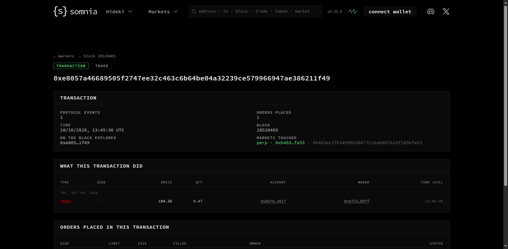

# Perps Copilot for dreamDEX

**Trade dreamDEX perpetuals from Telegram, with exits that close for you.**
Live on Somnia Tokyo testnet: [@SwiftPerpsBot](https://t.me/SwiftPerpsBot). Built by Swift Bot Labs for the dreamDEX Perps Builder Bounty (MVP track, category: bots and agents / trader tools).

Demo video (112 s, recorded live in Telegram Desktop): [video/demo.mp4](video/demo.mp4)

## What it does

- **Market orders in one line.** `/long ETH 20 5x` opens a 100 USDso ETH-PERP long (20 USDso margin at 5x) as a real order on dreamDEX. `/short`, `/close ETH`, `/close ETH 50%` work the same way. Every reply carries the transaction hash.
- **Positions with PnL.** `/positions` shows size, entry, mark, unrealised PnL, return on margin, the liquidation price and how far away it is.
- **Exits that act.** `/tp ETH 4%`, `/sl ETH 2300`, or inline: `/short BTC 15 10x tp 3% sl 1.5%`. The bot follows each market you hold through **Somnia Reactivity** and closes the position when a level is reached. A take-profit exits with an order capped at the TP price, so it never fills worse than the level; a stop-loss exits at market.
- **Liquidation alerts, and a guard.** You get a warning with *Close 50%* / *Close all* buttons when the mark comes within your distance of the liquidation price (`/alerts 10`). `/guard 3` closes the position for you when it gets within 3%.
- **PnL cards to share.** `/card` (or the *PnL card* button) renders an image of the trade with a mark-price sparkline and a personal deep link (`t.me/SwiftPerpsBot?start=r_<code>`). New traders who open the link land in the same onboarding. This is the repeat-use and growth loop: trade, get a card, forward it, friends start from the card.

## Who it is for

Perps traders who live in Telegram: people who want to act on a move from their phone in seconds, keep a stop on a position without watching a chart, and post their trades to their groups. It also suits bot builders who want a working reference for dreamDEX's "Link a bot" trading keys.

## How the bot gets permission to trade (no custody)

You never give the bot your wallet. On `/start` the bot generates a **personal bot key** for you and shows only its address. You link that address in the dreamDEX app:

1. app.testnet.dreamdex.io, open the wallet, **Link a bot**.
2. Paste the bot address, keep **Perps** ticked, press **Add bot** (the app offers to send it 5 STT for gas).
3. Press **I've linked it** in Telegram. The bot finds your account from the on-chain grant and checks which markets it covers.

"Link a bot" writes an operator grant for `placeOrderFor`, `cancelOrderFor` and `reduceOrderFor` on each perp pool. From then on every order the bot sends is `placeOrderFor(yourAccount, ...)`: the order, its margin and its fills are yours. **The key pays gas and nothing else. It cannot withdraw or move funds**, and you can remove it in the app at any time.


## Commands

| Command | What it does |
|---|---|
| `/start` | Onboarding, your bot key, the Link a bot steps |
| `/long ETH 20 5x` / `/short BTC 15 10x` | Market order: margin in USDso x leverage; optional `tp 4% sl 2%` or absolute prices |
| `/close ETH` / `/close ETH 50%` | Close all or part of a position |
| `/positions` | Positions, PnL, liquidation price and distance, watched exits |
| `/tp ETH 2500`, `/sl ETH 2%`, `/tp ETH off` | Bot-watched take-profit / stop-loss |
| `/alerts 10`, `/guard 3`, `/guard off` | Liquidation warning distance; auto-close distance |
| `/card [ETH]` | PnL card image with your share link |
| `/markets`, `/status`, `/key` | Marks and max leverage, account + gas + live streams, your bot key |

Leverage: the venue sets margin per market (5 %, 10 % or 20 % initial margin, i.e. 20x / 10x / 5x max), and the account's own cap is owner-only. The bot treats `5x` as sizing (notional = margin x leverage), checks it against the market maximum and the account cap, and asks the pool (`getMaxPerpOrderSize`) whether the account can take the size before anything is sent.

## Somnia Reactivity (how the exits are watched)

For every market that a user holds, the bot opens one `eth_subscribe("somnia_watch", ...)` subscription on the perp pool with `eth_calls = [pool.tryGetMarkPrice()]` and `push_changes_only = true`. The chain then pushes the new mark, already evaluated at the same block, about once a second, and each push re-checks the take-profit, stop-loss and liquidation distance of the users in that market. Measured live: TP hit to close transaction in about 4 seconds.

Fallback: if a market's stream is silent for 15 s the bot reads the mark over HTTP every 5 s, and re-subscribes after 90 s of silence. `/status` shows the live streams and their push counts.

Limits, said plainly: these are bot-side exits, not on-chain stop orders (a linked key cannot arm the venue's stop orders; only the account can). They work while the bot runs.

## Evidence (real orders on Somnia Tokyo testnet)

All orders below were placed **by the bot**, through a bot key linked with the app's Link a bot, for the dreamDEX account `0x0e7E8DF6Eac2E14165b4fA4CB2BD4e445d0E3817`. The full table, re-verified from chain receipts by `scripts/evidence.ts`, is in [evidence/orders.md](evidence/orders.md) (CSV: [evidence/orders.csv](evidence/orders.csv)).

24 orders on 2026-10-20, all `success`: 12 opens and 12 closes, of which 6 were fired by the bot itself (take-profit / stop-loss through Somnia Reactivity).

| time (UTC) | action | market | side | filled | avg price | tx | block | status |
|---|---|---|---|---|---|---|---|---|
| 10-20 13:43:08 | open | SOL-PERP | long | 0.47 | 104.19 | [0x7a0b04047f…](https://smk-dev-markets-explorer-hideki-euw4-uzavbo36ra-ez.a.run.app/tx/0x7a0b04047f3a6897421d09189d5578443c40faf5eb005c0b581a3f6f19a24729) | 28518981 | success |
| 10-20 13:45:36 | close (take-profit) | SOL-PERP | short | 0.47 | 104.36 | [0xe8057a4668…](https://smk-dev-markets-explorer-hideki-euw4-uzavbo36ra-ez.a.run.app/tx/0xe8057a46689505f2747ee32c463c6b64be04a32239ce579966947ae386211f49) | 28520465 | success |
| 10-20 13:46:12 | open | BTC-PERP | short | 0.00061 | 81862.3 | [0xc564b98f59…](https://smk-dev-markets-explorer-hideki-euw4-uzavbo36ra-ez.a.run.app/tx/0xc564b98f598de76c639c522654ae7d693c6693096d546a7771f154b626b91a36) | 28520827 | success |
| 10-20 13:46:26 | close (take-profit) | BTC-PERP | long | 0.00061 | 81870.811 | [0xa8bb33dfb4…](https://smk-dev-markets-explorer-hideki-euw4-uzavbo36ra-ez.a.run.app/tx/0xa8bb33dfb49816ede7fc160f1ab929bfdf525dbf1303af1a1c7fc61c5a49cdcd) | 28520958 | success |
| 10-20 13:46:36 | open | HYPE-PERP | long | 0.38 | 78.96 | [0x38910bb3ed…](https://smk-dev-markets-explorer-hideki-euw4-uzavbo36ra-ez.a.run.app/tx/0x38910bb3edcc6a772f62a0525def347abe2a7f322bbf8c46da3893bdc6427d03) | 28521060 | success |
| 10-20 13:49:39 | close | HYPE-PERP | short | 0.38 | 79.04 | [0xfbf488611a…](https://smk-dev-markets-explorer-hideki-euw4-uzavbo36ra-ez.a.run.app/tx/0xfbf488611a9c723e6c5a6d7a585a083e10d1e9b0840c08430620c3429dc4b57a) | 28522895 | success |
| 10-20 13:50:02 | open | ETH-PERP | long | 0.0416 | 2402.66 | [0x0651789850…](https://smk-dev-markets-explorer-hideki-euw4-uzavbo36ra-ez.a.run.app/tx/0x0651789850cbecf5d55614eee9fa91755fb8d20239e60e6aad0310bd2ae6127a) | 28523123 | success |
| 10-20 13:50:23 | open | XRP-PERP | short | 38.4 | 1.3016 | [0x157a3747e4…](https://smk-dev-markets-explorer-hideki-euw4-uzavbo36ra-ez.a.run.app/tx/0x157a3747e43cd88931cf840962255371c0f7964e795f102b1eb3404740b7dc60) | 28523326 | success |
| 10-20 13:51:25 | close | ETH-PERP | short | 0.0312 | 2395.04 | [0x4aaa17bc3e…](https://smk-dev-markets-explorer-hideki-euw4-uzavbo36ra-ez.a.run.app/tx/0x4aaa17bc3eff9308b2645da233e531e28d5197a3fa2ac962212bbe37de5f9d07) | 28523948 | success |
| 10-20 13:58:34 | close (stop-loss) | XRP-PERP | long | 38.4 | 1.3053 | [0xc95db7bb8c…](https://smk-dev-markets-explorer-hideki-euw4-uzavbo36ra-ez.a.run.app/tx/0xc95db7bb8c6f11bfd6e7172a8396953cde44e17b2d643b27d4ceb884816acd05) | 28528233 | success |
| 10-20 14:02:28 | open | SOL-PERP | long | 0.94 | 105.78 | [0x758d1df818…](https://smk-dev-markets-explorer-hideki-euw4-uzavbo36ra-ez.a.run.app/tx/0x758d1df8185e9700fe86b9136f275084d3a2782b009f3d4562a05ca687073edb) | 28530577 | success |
| 10-20 14:02:58 | close (take-profit) | SOL-PERP | short | 0.94 | 106.01 | [0x6395a19d28…](https://smk-dev-markets-explorer-hideki-euw4-uzavbo36ra-ez.a.run.app/tx/0x6395a19d28ad5d9251cd8730699185103dbd4a2bebbebe5868149299c00e9d73) | 28530875 | success |
| 10-20 14:03:30 | open | ETH-PERP | long | 1.6561 | 2417.43 | [0x0a8694c386…](https://smk-dev-markets-explorer-hideki-euw4-uzavbo36ra-ez.a.run.app/tx/0x0a8694c3861f1be6aa762f90e70076e5ae36ff0344f640d04b48191fbef79acf) | 28531195 | success |
| 10-20 14:05:18 | close | ETH-PERP | short | 1.6873 | 2420.9994 | [0x801a52b50d…](https://smk-dev-markets-explorer-hideki-euw4-uzavbo36ra-ez.a.run.app/tx/0x801a52b50d912f2ca5e026bc1bddebdf4fa64fef0b174e9f0a96844664bd5b3f) | 28532274 | success |
| 10-20 14:11:41 | open | ETH-PERP | long | 1.6338 | 2449.51 | [0xef6e6a06ea…](https://smk-dev-markets-explorer-hideki-euw4-uzavbo36ra-ez.a.run.app/tx/0xef6e6a06eae11c202393486540b3e3101f61d1668f7d5328891f55c8bdc2a9d3) | 28536102 | success |
| 10-20 14:12:05 | close | ETH-PERP | short | 1.6338 | 2450.4 | [0x072a0821aa…](https://smk-dev-markets-explorer-hideki-euw4-uzavbo36ra-ez.a.run.app/tx/0x072a0821aa9e85856205d8ff33aecb963f58a0f9dd6b78d7f7a6f5793f155992) | 28536337 | success |
| 10-20 14:13:10 | open | SOL-PERP | long | 0.93 | 107.15548 | [0xb46cc3e5ba…](https://smk-dev-markets-explorer-hideki-euw4-uzavbo36ra-ez.a.run.app/tx/0xb46cc3e5ba62fcaac49672a7a4ab90f7e57540766f78b35a450341f18c47734e) | 28536992 | success |
| 10-20 14:13:18 | close (stop-loss) | SOL-PERP | short | 0.93 | 107.05 | [0x1cf63b3601…](https://smk-dev-markets-explorer-hideki-euw4-uzavbo36ra-ez.a.run.app/tx/0x1cf63b360116054766b547d4031b65fdc139759e5d501e760f4b6d195586656b) | 28537071 | success |
| 10-20 14:13:54 | open | ETH-PERP | long | 1.6321 | 2453.1275 | [0x1118b65004…](https://smk-dev-markets-explorer-hideki-euw4-uzavbo36ra-ez.a.run.app/tx/0x1118b65004b7a6afd3bbd62a56c9064ae4e16ff6162ed985cc1ea72a05f143de) | 28537435 | success |
| 10-20 14:15:04 | close | ETH-PERP | short | 1.6321 | 2471.2668 | [0x12c27d9e87…](https://smk-dev-markets-explorer-hideki-euw4-uzavbo36ra-ez.a.run.app/tx/0x12c27d9e879639548e799444c3d0af76a6f42f0f7d8ae4241f83d1f43129bdff) | 28538128 | success |
| 10-20 14:17:52 | open | SOL-PERP | long | 0.92 | 107.97 | [0x38fa57f33f…](https://smk-dev-markets-explorer-hideki-euw4-uzavbo36ra-ez.a.run.app/tx/0x38fa57f33f8217457db1d329361cbc078607504bad1f43a703b64d26c86708ff) | 28539810 | success |
| 10-20 14:18:29 | close (stop-loss) | SOL-PERP | short | 0.92 | 107.95 | [0x6c37d66515…](https://smk-dev-markets-explorer-hideki-euw4-uzavbo36ra-ez.a.run.app/tx/0x6c37d6651549ce75974e50096882ecf1b4eebc3199c2eb2f64b6706156b53d17) | 28540182 | success |
| 10-20 14:19:02 | open | ETH-PERP | long | 1.6271 | 2458.2179 | [0x426548fd87…](https://smk-dev-markets-explorer-hideki-euw4-uzavbo36ra-ez.a.run.app/tx/0x426548fd875ff6c74f82b5c18bc1835170d0bc35d1af94d92295e0abb42d15dc) | 28540509 | success |
| 10-20 14:19:30 | close | ETH-PERP | short | 1.6271 | 2460.91 | [0x53f1f7f7f5…](https://smk-dev-markets-explorer-hideki-euw4-uzavbo36ra-ez.a.run.app/tx/0x53f1f7f7f5efbe2fecfab50c4cfc9e24cff200bc7eb7c92dc1d818824897b9b5) | 28540785 | success |



## X posts

<!-- 2-3 posts about the MVP tagging @DreamDEXSomnia go here -->
- (link to post 1)
- (link to post 2)
- (link to post 3)

## Run it yourself

Requirements: Node 22, a Telegram bot token, Linux with `bwrap` for the jail (optional for local runs).

```bash
git clone https://github.com/swiftbotlab/dreamdex-perps-copilot && cd dreamdex-perps-copilot
npm ci --ignore-scripts
npm test                      # 24 tests: parsing, key vault, card, protection engine, close races
npm run build                 # bundles dist/bot.mjs + dist/resvg.wasm

# secrets live outside the repo, one KEY=VALUE per line, chmod 600
printf 'BOT_TOKEN=123:abc\n' > ~/secrets/ddmvp_bot.env
printf 'DDMVP_MASTER_KEY=%s\n' "$(openssl rand -hex 32)" > ~/secrets/ddmvp_master.env
chmod 600 ~/secrets/*.env

DDMVP_ROOT=$PWD DDMVP_BOT_ENV=~/secrets/ddmvp_bot.env DDMVP_MASTER_ENV=~/secrets/ddmvp_master.env \
  node --require ./ops/guard.cjs dist/bot.mjs
```

Production runs it as a systemd user service inside a bubblewrap jail: `ops/ddmvp.service` -> `ops/run_sandboxed.sh bot`. See [SECURITY.md](SECURITY.md).

## Architecture

```
Telegram  <-- long polling (Bot API over fetch) -->  src/bot.ts   commands, buttons, per-user queues + rate limits
                                                        |
           src/parse.ts  every user token validated     |  src/keys.ts   per-user bot keys, AES-256-GCM at rest
                                                        v
                                                   src/venue.ts   one read client for everyone (markets-sdk 0.31.0)
                                                        |          + per-user trading key: placeOrderFor(owner, ...)
                                                        v
 Somnia Tokyo testnet (Hideki, chain 50383): perp pools, MarginBank, OperatorPermissionsRegistry
                                                        ^
                                                   src/protect.ts  somnia_watch mark pushes -> TP / SL / guard / warnings
                                                   src/card.ts     SVG -> PNG with resvg (WebAssembly)
```

- Testnet only: the bot asserts chain id 50383 at startup and refuses anything else.
- Reads (positions, mark, liquidation price, margin, max order size, close preview) take the account explicitly, so one client serves all users.
- Writes use the trading-key helpers from the official dreamDEX bot kit (`src/vendor/perp-core`, MIT, one change: no `.env` loading).
- Market orders are immediate-or-cancel at the touch +/- 30 bps, refused when the book is more than 1.5 % from the mark.

## Roadmap

`/follow <address>` copy mode (mirror a trader's fills into your account at your size), resting limit orders, group mode for trading clubs, and mainnet once dreamDEX perps launch there.

## Disclaimer

Testnet software for paper USDso. Not financial advice. Swift Bot Labs is not affiliated with dreamDEX or Somnia.
