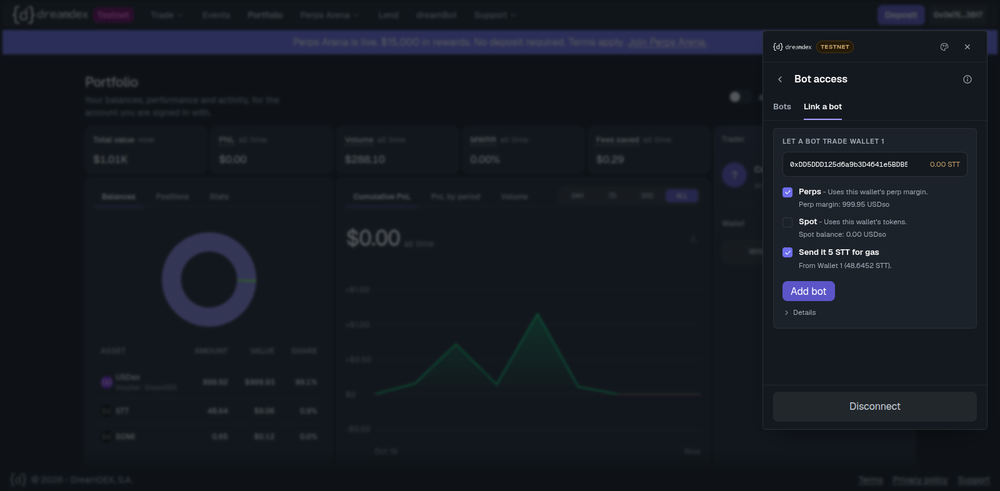

# Perps Copilot for dreamDEX

**Trade dreamDEX perpetuals from Telegram: one-line orders, exits that close for you, a check of the TP/SL the chain holds for you, and cards your friends can copy.**
Live on Somnia Tokyo testnet: [@SwiftPerpsBot](https://t.me/SwiftPerpsBot). Built by Swift Bot Labs for the dreamDEX Perps Builder Bounty (MVP track). Category: consumer perps, and a trader tool.

## Judges start here

**What it is.** A Telegram bot that trades your own dreamDEX perps account through a key you link with the app's Link a bot (it can place and close orders, it can never withdraw). It watches every market you hold through Somnia Reactivity, closes at your take-profit, stop-loss or liquidation guard, reads the TP/SL that dreamDEX's chain holds for you and warns when one would close only part of your position or nothing, and turns trades into cards a friend opens on their own account with one tap.

**Who it is for.** Perps traders who live in Telegram and want to act from their phone in seconds (consumer perps), and anyone who wants a second pair of eyes on an account: `/stops` and `/watch` work on any address, read only (trader tool).

**Try it, no wallet:**
1. `/try`: one real order in about 5 seconds on the bot's own testnet sandbox account. 12 USDso, closed by itself at ±0.3 % or within 10 minutes, and you get the tx link and how it ended (2 a day per person).
2. `/demo`: the bot's own live account, its last orders with tx links, the last bot-fired exit and the live Reactivity streams.
3. `/stops 0xAnyAccount`: the dreamDEX TP/SL the chain holds for that account, each one checked against the position and the pool's closing capacity.
4. `/watch 0xAnyAccount`: liquidation pings for any account.

Then `/start`, Link a bot in the app, and `/long ETH 20 5x tp 4% sl 2%`.

<!-- evidence:headline -->
**Evidence.** 37 real orders sent by the bot, 37 verified `success` on chain, 9 of them exits the bot fired by itself, on 3 days (newest 2026-10-29 06:08 UTC); scheduled demo trades keep adding three a day until Nov 1. Latest measured time from the pushed mark crossing a TP/SL level to the confirmed close: 2.5 s.
<!-- /evidence:headline -->
- Evidence page (every order re-read from its receipt, the chain-held stop check run step by step): **https://swiftbotlab.github.io/dreamdex-perps-copilot/**
- **Chain-fired stop-loss, live:** with the bot process stopped, Somnia Reactivity woke our ExitGuard contract on the demo account (an EIP-7702 account) and it closed the bot-opened HYPE long by itself. [How and the tx hashes](#chain-fired-stop-loss-exitguard).
- Order table: [evidence/orders.md](evidence/orders.md) · [CSV](evidence/orders.csv) · [JSON](evidence/orders.json)
- Demo video (112 s, YouTube): https://youtu.be/rWLEHY_x_j4 (recorded 2026-10-20: orders, a bot-fired stop-loss, a liquidation alert, `/card`; also as [demo.mp4 on the v1.0.0 release](https://github.com/swiftbotlab/dreamdex-perps-copilot/releases/download/v1.0.0/demo.mp4))

| Judging criterion | Where to look |
|---|---|
| MVP potential: user value, scope, repeat-use loop, execution | [Two layers of protection](#two-layers-of-protection), [Chain-fired stop-loss](#chain-fired-stop-loss-exitguard), [Loops](#loops), [Reliability](#reliability), [Architecture](#architecture), 141 bot tests + 26 contract tests (+2 fork tests) |
| Evidence of building: live orders, tx hashes, repo, demo | [Evidence page](https://swiftbotlab.github.io/dreamdex-perps-copilot/), [Evidence](#evidence-real-orders-on-somnia-tokyo-testnet), the video |
| Communication: X posts | [X posts](#x-posts) |

## Two layers of protection

A stop is only as alive as whatever holds it. dreamDEX already holds TP/SL on chain: each market's stop registry wakes every pending stop and fires it with no bot at all. Perps Copilot builds on that instead of replacing it.

1. **Chain-held (dreamDEX's own TP/SL).** `/stops` reads every pending stop from its registry and checks it: resting orders on the closing side that cut a stop to part of the position or to nothing (the registry sizes a fired stop to the pool's reducing capacity, and a stop below the minimum size is dropped), a size fixed at arming that no longer covers a grown position, a stop on the wrong side or with no position left, a linked pair whose partial fill cancels the other leg. Linked users get the warning unprompted within a minute, and a note when a chain-held stop fired, was dropped or was cancelled by its partner. `/positions` shows both layers side by side.
2. **Bot-side (fast second layer).** `/tp`, `/sl` and `/guard`: the bot follows every market you hold through Somnia Reactivity (`somnia_watch` with `tryGetMarkPrice()` evaluated at the pushed block) and closes the position when a level is reached. A take-profit exits with an order capped at the TP price, so it never fills worse than the level. This layer runs while the bot runs; the chain-held layer does not need it.
3. **Chain-fired, our own (new, 2026-10-29).** ExitGuard: an EIP-7702 account that Somnia Reactivity wakes every 5 s and that closes its own position at the stop, with no bot running. Live on the demo account; see [Chain-fired stop-loss](#chain-fired-stop-loss-exitguard).

Live run on 2026-10-29 (account `0x2A11…bF08`, every step on the [evidence page](https://swiftbotlab.github.io/dreamdex-perps-copilot/)): a linked TP/SL bracket was armed on an XRP-PERP long, `/stops` showed both legs OK; then a post-only sell of 7 XRP was rested 20 % above the market, and 5 s later `/stops` said *"will close NOTHING when it fires. Your resting sell orders on XRP-PERP (7 XRP) use up the position's closing capacity, so the stop is dropped (ReduceOnlyBelowMinQty)"*. The same warning arrived unprompted 56 s after the order. Cancelling the order restored both legs.

## Chain-fired stop-loss (ExitGuard)

The third layer, and the one the chain runs end to end. [`chain/src/ExitGuard.sol`](chain/src/ExitGuard.sol) is our own small contract that an account points its code at with one EIP-7702 transaction. The account arms a stop on itself; Somnia Reactivity then wakes the account every 5 s (a one-shot `Schedule` it renews on every wake) and at every epoch. When the pool's mark crosses the level, the account closes its own position with one immediate-or-cancel order in that same reactive transaction: no bot, no keeper, nobody signs. **What is chain-held now:** the stop on the bot's demo account `0x2A11…bF08` (its owner key armed it; a linked bot key cannot, so other users would arm it from their own wallet), one market at a time. The code can only reduce the account's own position, sized from the position read in the same transaction, filling at most the slippage set at arming (1 % here) from the mark; it makes no approvals, transfers or other calls ([threat model](SECURITY.md#chain-fired-stop-exitguard-eip-7702--somnia-reactivity); 26 unit tests including a fuzz test, and 2 tests on a fork of the live HYPE-PERP pool that passed on earlier versions but are flaky on Somnia's RPC). **Limits and costs, measured:** each wake costs the account about 0.0026 STT (the check, booking the next wake and removing the used one), so ~1.8 STT an hour at 5 s; the account must hold 32 STT to book wake-ups (the precompile's minimum, not spent; below it the epoch heartbeat still checks every ~5 minutes); one-off costs were ~33M gas to deploy (~0.2 STT), 1.19M gas to delegate and 0.6-1.4M to arm. The bot-side exits stay as the fallback, set wider (here -1.5 % against the chain-fired -0.06 %), and `/stops` shows "Chain-fired stop armed" with how many times the chain has checked it. The run below used a level 0.06 % under the mark so it would fire within minutes.

**What it took (two designs retired on the way, both on chain in [evidence/exitguard_ops.jsonl](evidence/exitguard_ops.jsonl)):** v1 woke on every new order on the HYPE-PERP book; market makers re-quote ladders of ~9 orders per block, so it was called 363 times in 30 s and would have cost up to ~36 STT an hour. v2 moved to a schedule but renewed only when the wake-up's topic 1 equalled the booked time, and the precompile passes the time it fired (booked time rounded up to the block), so it never renewed. v3 compares with `>=` and removes each used one-shot, which on Somnia stays listed until it is removed.

<!-- evidence:chainstop -->
| UTC (2026-10-29) | step | tx |
|---|---|---|
| 05:24:23 | `/long HYPE 2 5x sl 1.5%` in Telegram: the bot opens 0.12 HYPE through its linked key | [`0x1722a8ce…`](https://explorer.testnet.somnia.network/tokyo/tx/0x1722a8ce06557ccbf2afdb3f0ce39d9c886fb23b91d488ea8bb1db2325e3d030) |
| 06:00:18 | ExitGuard deployed (9967 bytes, 33,228,665 gas) | [`0x7d848f1a…`](https://explorer.testnet.somnia.network/tokyo/tx/0x7d848f1a1b604bd30ea15ae0fd062efd62b4e964f67b618d425716aee7ec5605) |
| 06:00:31 | EIP-7702 type-4 tx: the demo account's code becomes `0xef0100` + ExitGuard (1,191,067 gas) | [`0x39b25d4f…`](https://explorer.testnet.somnia.network/tokyo/tx/0x39b25d4f99f5468f23bc1abca966c5ce026e54ec8ddc5f8e978e5c8cc1e56045) |
| 06:01:23 | Armed on the account: SL 79.21 (mark 79.264), at most 1.00 % slippage; Reactivity subscriptions 23451436 (a wake-up every 5 s, renewed on each wake) and 23451437 (every epoch) (606,733 gas) | [`0x28b80fdf…`](https://explorer.testnet.somnia.network/tokyo/tx/0x28b80fdf62b770332a0314a9cf0a592aa4f6ce8e444c33dbcbbb9d9e0c44ff78) |
| 06:02:21 | `systemctl --user stop ddmvp`: bot process stopped | - |
| 06:04:03 | **stop-loss fired by the chain** after 33 checks: mark 79.2078 <= 79.21, whole position sold at 79.19 in the same transaction, both subscriptions removed. Reactive tx: from = to = the account, nonce `604088341364736` = block 36006471, queue position 0, signature r = s = 0x1 (1,706,154 gas) | [`0x2be38f67…`](https://explorer.testnet.somnia.network/tokyo/tx/0x2be38f67d9ceafae7168c7ee1db6fd25b2075c25b7f5245dcf2df9074f72ec89) |
| 06:04:50 | `systemctl --user restart ddmvp`: bot back, position already closed | - |

Armed to fired 160 s, bot stopped to fired 102 s. Nonces across the window: demo account 51 → 51, bot key 35 → 35 (neither sent anything). From arming to the fire the account paid 0.094 STT: 33 wake-ups at ~0.00251 STT each and 0.0136 STT for the close.
<!-- /evidence:chainstop -->

## What it does

- **Market orders in one line.** `/long ETH 20 5x` opens a 100 USDso ETH-PERP long (20 USDso margin at 5x) as a real order on dreamDEX. `/short`, `/close ETH`, `/close ETH 50%` work the same way. Every reply carries the transaction hash.
- **Positions with PnL and both stop layers.** `/positions` shows size, entry, mark, unrealised PnL, return on margin, the liquidation price and distance, the chain-held TP/SL with their health, and the bot-side exits.
- **Chain-held stops, checked.** `/stops` (or `/stops 0x…` for any account) mirrors dreamDEX's own TP/SL and says, per stop, how much it will really close when it fires. Unprompted warnings once a day per stop and problem.
- **Exits that act.** `/tp ETH 4%`, `/sl ETH 2300`, or inline: `/short BTC 15 10x tp 3% sl 1.5%`. Closed through Somnia Reactivity pushes; a take-profit never fills worse than its level.
- **Liquidation alerts, and a guard.** A warning with *Close 50%* / *Close all* buttons when the mark comes within your distance of the liquidation price (`/alerts 10`). `/guard 3` closes the position for you when it gets within 3 %.
- **Cards friends can copy.** `/card` renders an image of the trade (with a mark-price sparkline). Forward it anywhere: **Copy this trade** opens a landing with the trade, the mark now and the move since entry, then a 10 / 25 / 50 USDso preview and a single-use Confirm (optionally with a 3 % stop-loss). The copy is a one-time order on the copier's own account, never filled more than 0.5 % from the mark.
- **Watch any account.** `/watch 0x…` warns once when a position on that account nears liquidation (again only if it gets twice as close) and says when a warned position is gone. Every alert offers **Guard it: link this account**.
- **A demo for anyone.** `/demo` shows the bot's own live account and its recent orders before you link anything, and `/try` places one real, capped order on that sandbox account for anyone, with no wallet (it closes itself within 10 minutes).

## Loops

- **Copy loop.** Trade, `/card`, forward. A friend taps **Copy this trade**: a new user's tapped card waits through onboarding and comes back right after they link. The sharer gets a short attribution ping (at most 6 an hour) and `/invite` counts the taps, new users and copies of their cards. The landing never shows the sharer's account or Telegram identity.
- **Watch loop.** `/watch` and `/stops` work for any account with no link. Each liquidation alert offers to link the account so that `/guard` can act, not only warn.
- **Repeat use.** Exits, liquidation alerts and stop-health warnings bring the trader back on every move, and on every change to their orders that silently breaks a stop.

### Share-link flow, step by step (what is on-chain and what is bot-side)

1. `/card` (bot-side): the bot renders the PNG and stores a card record (market, side, leverage, entry, exit or mark). The link `t.me/SwiftPerpsBot?start=c_<id>` is on the **Copy this trade** button, in the caption and printed on the image.
2. Forward (Telegram): the card can go to any chat or group; the bot does not need to be in it. Checked live on 2026-10-26: a card forwarded to Saved Messages kept its **Copy this trade** URL button with the same link.
3. Tap (bot-side): the landing shows the trade, the mark now and the move since entry. A user who has not linked yet goes through `/start` first, and the card comes back right after the link.
4. Margin button, then preview (bot-side, nothing sent): 10 / 25 / 50 USDso, leverage capped at 10x and at the market maximum, and a single-use draft that expires after 10 minutes.
5. Confirm (on-chain): one `placeOrderFor(copierAccount, ...)` immediate-or-cancel order on the perp pool, sent by the copier's own linked bot key, with the limit price at most 0.5 % from the mark. This is the only step that touches the chain.
6. After the fill (bot-side): an optional 3 % stop-loss watched through Somnia Reactivity, the sharer's attribution ping, and the counts in `/invite`.


## How the bot gets permission to trade (no custody)

You never give the bot your wallet. On `/start` the bot generates a **personal bot key** for you and shows only its address. You link that address in the dreamDEX app:

1. app.testnet.dreamdex.io, open the wallet, **Link a bot**.
2. Paste the bot address, keep **Perps** ticked, press **Add bot** (the app offers to send it 5 STT for gas).
3. Press **I've linked it** in Telegram. The bot finds your account from the on-chain grant and checks which markets it covers.

"Link a bot" writes an operator grant for `placeOrderFor`, `cancelOrderFor` and `reduceOrderFor` on each perp pool. From then on every order the bot sends is `placeOrderFor(yourAccount, ...)`: the order, its margin and its fills are yours. **The key pays gas and nothing else. It cannot withdraw or move funds**, and you can remove it in the app at any time.



## Commands

| Command | What it does |
|---|---|
| `/try` | One real order on the bot's own testnet sandbox account, no wallet: 12 USDso, closed by itself within 10 minutes; 2 a day per person, 12 a day in total |
| `/demo` | A live account run by this bot: equity, positions, last orders with tx links, live streams, chain link. No wallet needed |
| `/stops` / `/stops 0x…` | The dreamDEX TP/SL the chain holds for your account (or any account, read only), each checked against the position and the pool's closing capacity |
| `/watch 0x…` / `/unwatch` | Liquidation pings for any account, read only (up to 3; they end after 7 days without a message from you) |
| `/start` | Onboarding, your bot key, the Link a bot steps |
| `/long ETH 20 5x` / `/short BTC 15 10x` | Market order: margin in USDso x leverage; optional `tp 4% sl 2%` or absolute prices |
| `/close ETH` / `/close ETH 50%` | Close all or part of a position |
| `/positions` | Positions, PnL, liquidation price and distance, chain-held and bot-side exits |
| `/tp ETH 2500`, `/sl ETH 2%`, `/tp ETH off` | Bot-side take-profit / stop-loss |
| `/alerts 10`, `/guard 3`, `/guard off` | Liquidation warning distance; auto-close distance |
| `/card [ETH]` | PnL card image with a **Copy this trade** link |
| `/invite` | Your invite link, who joined through it, and your cards' taps / new users / copies (30 days) |
| `/markets`, `/status`, `/key` | Marks and max leverage, account + gas + live streams + chain link, your bot key |

Leverage: the venue sets margin per market (5 %, 10 % or 20 % initial margin, i.e. 20x / 10x / 5x max), and the account's own cap is owner-only. The bot treats `5x` as sizing (notional = margin x leverage), checks it against the market maximum and the account cap, and asks the pool (`getMaxPerpOrderSize`) whether the account can take the size before anything is sent.

## Somnia Reactivity (how the bot-side exits are watched)

For every market that a user holds, the bot opens one `eth_subscribe("somnia_watch", ...)` subscription on the perp pool with `eth_calls = [pool.tryGetMarkPrice()]` and `push_changes_only = true`. The chain pushes the new mark, already evaluated at the same block, on each pool event that changes the mark, and each push re-checks the take-profit, stop-loss and liquidation distance of the users in that market. Since 2026-10-29 every bot exit logs the time of the push that triggered it, and `/demo` and the evidence page show the time from that push to the confirmed close (first measured: 3.4 s, an XRP-PERP stop-loss).

Fallback: if a market's stream is silent for 15 s the bot reads the mark over HTTP every 5 s, and re-subscribes after 90 s of silence. Watched accounts (`/watch`) ride on the same streams.

## Reliability

- **Self-healing chain link.** On 2026-10-27 the WebSocket client the SDK reads with stopped reconnecting (viem gives up after 5 tries and keeps the dead socket cached by URL), and every account read failed for about 28 hours while the process looked healthy. Now a watchdog probes the chain every 30 s: 6 failed checks in a row close the cached sockets, rebuild the client and re-subscribe the push streams; 6 more stop the bot so systemd restarts it (`Restart=always`, growing delays up to 5 min, no start limit). `/status` and `/demo` show when the link was last verified. `test/watchdog.test.ts` reproduces the failure with the real SDK and a local WebSocket server (still dead after the server returns) and shows the rebuild heals it.
- **Scheduled demo trades.** Three times a day (03:20, 11:20, 19:20 UTC, until 2026-11-01) the bot opens one 12 USDso position on its demo account with a bot-side TP/SL 0.3 % away and flattens it after 45 minutes if neither fired. One position at a time, an equity floor, an off switch, tagged "scheduled demo trade". They go through the same open, Reactivity exit and close paths as a user's order and keep the evidence fresh.
- **Sends you can trust.** Each order is signed in the bot and its hash is known before it is posted; failures are labelled by the step that failed, an order that may have reached the chain is never reported as "nothing was sent" and never resent automatically.
- **One instance, clean restarts.** A heartbeat lock refuses a second copy; on a restart the bot finishes orders in flight (at most 70 s) before releasing it.

## Evidence (real orders on Somnia Tokyo testnet)

All orders were placed **by the bot**, through a bot key linked to the account with dreamDEX's operator grant (the one the app's Link a bot writes), each a `placeOrderFor(account, ...)` immediate-or-cancel order on a perp pool. `scripts/evidence.ts` re-reads every one from its receipt (status, sender = the linked bot key, the `placeOrderFor` account) and writes [evidence/orders.md](evidence/orders.md), [CSV](evidence/orders.csv) and [JSON](evidence/orders.json); `scripts/evidence_page.ts` builds the [evidence page](https://swiftbotlab.github.io/dreamdex-perps-copilot/) from them.

Accounts: from 2026-10-29 the demo account is `0x2A11e7388D1D2F9690f2636846d44b478f61bF08`, an account outside the Perps Arena holding testnet USDso bought with faucet STT. The orders of 2026-10-20 and 2026-10-26 went to the earlier demo account `0x0e7E8DF6Eac2E14165b4fA4CB2BD4e445d0E3817` (paper USDso from its own airdrop); `/demo` counts both.

<!-- evidence:summary -->
37 orders (19 opens, 18 closes), 37/37 verified `success`: 24 on 2026-10-20, 4 on 2026-10-26, 9 on 2026-10-29. 9 closes were fired by the bot itself (take-profit, stop-loss or guard). All of them are on our own demo accounts; the bot has had no outside users yet. Generated 2026-10-29 06:11 UTC.
<!-- /evidence:summary -->

<!-- evidence:latest -->
Newest 10 (all 37 in [evidence/orders.md](evidence/orders.md)):

| UTC | action | market | filled | avg price | tx | status | trigger to close |
|---|---|---|---|---|---|---|---|
| 10-29 06:08 | close | HYPE-PERP short | 0.12 | 79.26 | [`0x5a5fe920…`](https://explorer.testnet.somnia.network/tokyo/tx/0x5a5fe92063759d721ecddee54b35c245de15fc96e4de45fab6aaff391a1c1903) | success |  |
| 10-29 06:07 | open | HYPE-PERP long | 0.12 | 79.31 | [`0x83107465…`](https://explorer.testnet.somnia.network/tokyo/tx/0x83107465b11200f9cb2969b70f416be5a38128e84c9bd47baa25b8280cdfbe48) | success |  |
| 10-29 05:24 | open | HYPE-PERP long | 0.12 | 79.37 | [`0x1722a8ce…`](https://explorer.testnet.somnia.network/tokyo/tx/0x1722a8ce06557ccbf2afdb3f0ce39d9c886fb23b91d488ea8bb1db2325e3d030) | success |  |
| 10-29 02:14 | close, stop-loss (bot) | ETH-PERP short | 0.0052 | 2301.86 | [`0xa148b523…`](https://explorer.testnet.somnia.network/tokyo/tx/0xa148b523b3cec41ad18b38e038fcad96018607f1dd3e93c59c6f8b1cf3a51d62) | success | 2.5 s |
| 10-29 02:08 | open | ETH-PERP long | 0.0052 | 2307.05 | [`0x19550901…`](https://explorer.testnet.somnia.network/tokyo/tx/0x195509016abd538ef75a14878fadf0bb17c1d71bead1439d29937262927aaba7) | success |  |
| 10-29 01:16 | close | XRP-PERP short | 9.1 | 1.3173 | [`0x2e6d136d…`](https://explorer.testnet.somnia.network/tokyo/tx/0x2e6d136d76c96a6ee7e79d711d0fb7cfab8c8cea9b8dc3c764c1a3ffae275c79) | success |  |
| 10-29 01:05 | open | XRP-PERP long | 9.1 | 1.3183 | [`0x4f70e96e…`](https://explorer.testnet.somnia.network/tokyo/tx/0x4f70e96e3db40293c1f44a96c516ab1ef9f72b07c396047766da437416fb424a) | success |  |
| 10-29 01:03 | close, stop-loss (bot) | XRP-PERP short | 9 | 1.3168 | [`0x4c443a40…`](https://explorer.testnet.somnia.network/tokyo/tx/0x4c443a40c1bf3cecb975e6a2bc6c29ee57238f36f7a1af87da46d3ef586f91b8) | success | 3.4 s |
| 10-29 00:53 | open | XRP-PERP long | 9 | 1.3209 | [`0x94302cd2…`](https://explorer.testnet.somnia.network/tokyo/tx/0x94302cd24d488b972634c6e3a98fc84f5da6c6fab4be4c3b22a93cc53a7bb775) | success |  |
| 10-26 02:18 | close, stop-loss (bot) | SOL-PERP short | 0.49 | 101.08 | [`0xae8c3ae7…`](https://explorer.testnet.somnia.network/tokyo/tx/0xae8c3ae7369b11bf307cc046a882f4071efae94fc0763fa987e454e0c31e0867) | success |  |
<!-- /evidence:latest -->

### Card copy evidence (live, 2026-10-26)

The first orders of this build, sent right after the restart that put the card-copy loop and `/watch` live. Same demo account and bot key as above, testnet only. The card copy is **our own card run back** on our own account (no second user yet); it went through the same landing, preview and single-use Confirm that any copier gets.

| UTC | step | tx | block | result |
|---|---|---|---|---|
| 02:14:00 | `/card` on the last closed trade (ETH-PERP long 10x, closed 10-20 at +4.38 USDso) | - (bot-side) | - | card `c_dd6869a3a6` with **Copy this trade** |
| 02:14:13 | `/start c_dd6869a3a6`, then **10 USDso** | - (bot-side) | - | preview: 10 x 10x = 100 USDso, fills only within 0.5 % of the mark |
| 02:14:47 | **Confirm + SL 3%**: copy open, ETH-PERP long 0.0432 @ 2,309.53 | [`0x887ca26690b163b68f7b9066c41a015152c05aab9646c91acd28cc5b97b0dbd7`](https://explorer.testnet.somnia.network/tokyo/tx/0x887ca26690b163b68f7b9066c41a015152c05aab9646c91acd28cc5b97b0dbd7) | 33287448 | success, `via card`; stop-loss 2,240.24 watched |
| 02:15:06 | the same Confirm button pressed again | - | - | refused: "expired or was already used", nothing sent |
| 02:16:48 | `/watch` a public third-party account (read only) | - | - | real alert: "BTC-PERP long, mark 79,685.59 is 2.6% from liquidation 77,588.70" at the default 10 % warning |
| 02:17:27 | the card forwarded to Saved Messages | - | - | the **Copy this trade** URL button survived the forward |
| 02:18:07 | `/close ETH` | [`0x74ff2f03338caa120fddfc49cf11425ea589d7ff5d1f08dd28cf565d7d012969`](https://explorer.testnet.somnia.network/tokyo/tx/0x74ff2f03338caa120fddfc49cf11425ea589d7ff5d1f08dd28cf565d7d012969) | 33289448 | success, closed 0.0432 @ 2,311.33 |
| 02:18:36 | `/long SOL 10 5x tp 0.15% sl 0.15%` (tight levels chosen so an exit fires quickly) | [`0xd08da31b0a328b6e9eb84817a99ef74b1e8431471737e3835d91b5dac403dee5`](https://explorer.testnet.somnia.network/tokyo/tx/0xd08da31b0a328b6e9eb84817a99ef74b1e8431471737e3835d91b5dac403dee5) | 33289744 | success, long 0.49 @ 101.14 |
| 02:18:41 | stop-loss 100.988 reached (mark 100.982), closed by the bot | [`0xae8c3ae7369b11bf307cc046a882f4071efae94fc0763fa987e454e0c31e0867`](https://explorer.testnet.somnia.network/tokyo/tx/0xae8c3ae7369b11bf307cc046a882f4071efae94fc0763fa987e454e0c31e0867) | 33289789 | success, closed 0.49 @ 101.08 |

These four orders are also the first live run of the hardened send path (signed in the bot, hash known before posting, one post per key at a time).


## What other builders can take from this

- **Marks without polling:** `eth_subscribe("somnia_watch", { address: [pool], eth_calls: [{ to: pool, data: tryGetMarkPrice() }], push_changes_only: true })` delivers the mark evaluated at the pushed block. Keep an HTTP fallback for silent streams.
- **A stop is worth what the pool lets it close:** read `PerpPool.getReducingCapacity(owner)` before trusting a TP/SL; resting orders on the closing side shrink it, and a fired stop below the pool minimum places nothing.
- **viem WebSockets can die quietly:** after 5 failed reconnects the dead socket stays cached by URL, so a new client for the same URL gets it back. Probe it and close the cached socket (or restart) instead.
- **Know how far the indexer is behind:** `getIndexerFreshness` gives the lag (we saw 151 s); for state you act on, read the registry or pool, or the contract's own logs.
- **On-chain Reactivity is paid per matched log:** a handler subscribed to a busy book's `OrderPlaced` was called ~9 times per block (363 calls in 30 s). For a stop, a self-renewing `Schedule` every few seconds is cheaper and predictable (~0.0026 STT per wake here).
- **`Schedule` wake-ups carry the time they fired, not the time you booked** (topic 1 = booked time rounded up to the block, in ms), and a fired one-shot stayed listed in `somnia_reactivityGetSubscriptions` until we unsubscribed it (~27k gas).
- **Never resend blind:** sign locally, know the hash before posting, label failures by the step that failed, and block new orders on that account and market until the chain says the old one is mined or gone.

## Mainnet plan

- The bot is testnet-only by design: it asserts chain id 50383 at startup. Mainnet becomes one reviewed config (chain id, RPC/WebSocket, indexer, registry addresses from dreamDEX's published list) behind an explicit switch that refuses to start otherwise.
- Day one on mainnet: the read-only features (`/stops`, `/watch`, `/demo`), which need no keys and carry no risk to users' funds.
- Orders: the same Link a bot permission (place and close, never withdraw), with lower caps at launch (margin and leverage) and scheduled canary trades on our own funded account for 48 hours before orders open to everyone, within the 30 days after dreamDEX perps go live on mainnet.
- Revenue later, without custody: the builder fee that `placeOrderFor` already carries (`builder`, `builderFeeBpsTimes1k`).

## X posts

Posts about Perps Copilot that tag @DreamDEXSomnia:

1. Chain-fired stop: with the bot stopped, Somnia Reactivity woke our EIP-7702 ExitGuard and the account closed its HYPE position by itself (2026-10-29): https://x.com/swiftbotlab/status/2115692549113557368
2. Thread: what you can try in 60 s without a wallet, and 30+ real orders on chain: https://x.com/swiftbotlab/status/2115630821919101255
3. Chain-held TP/SL, checked: a resting order that made an armed stop close nothing, flagged by `/stops` and an unprompted alert: https://x.com/swiftbotlab/status/2115630983320048077

## Run it yourself

Requirements: Node 22, a Telegram bot token, Linux with `bwrap` for the jail (optional for local runs).

```bash
git clone https://github.com/swiftbotlab/dreamdex-perps-copilot && cd dreamdex-perps-copilot
npm ci --ignore-scripts
npm test                      # 141 tests: parsing, key vault, card, protection, close races, send outcomes, card copies, /watch, /demo, /stops, watchdog, schedule, /try
npm run build                 # bundles dist/bot.mjs + dist/resvg.wasm
(cd chain && forge test)      # ExitGuard: 26 tests; fork tests on the live pool: see chain/test/ExitGuardFork.t.sol

# secrets live outside the repo, one KEY=VALUE per line, chmod 600
printf 'BOT_TOKEN=123:abc\n' > ~/secrets/ddmvp_bot.env
printf 'DDMVP_MASTER_KEY=%s\n' "$(openssl rand -hex 32)" > ~/secrets/ddmvp_master.env
chmod 600 ~/secrets/*.env

DDMVP_ROOT=$PWD DDMVP_BOT_ENV=~/secrets/ddmvp_bot.env DDMVP_MASTER_ENV=~/secrets/ddmvp_master.env \
  node --require ./ops/guard.cjs dist/bot.mjs
```

Production runs it as a systemd user service inside a bubblewrap jail: `ops/ddmvp.service` -> `ops/run_sandboxed.sh bot`. See [SECURITY.md](SECURITY.md).

## Architecture

```
Telegram  <-- long polling (Bot API over fetch) -->  src/bot.ts   commands, buttons, per-user queues + rate limits
                                                        |
           src/parse.ts  every user token validated     |  src/keys.ts   per-user bot keys, AES-256-GCM at rest
                                                        v
                                                   src/venue.ts   one read client for everyone (markets-sdk 0.31.0)
                                                        |          + per-user trading key: placeOrderFor(owner, ...)
                                                        v
 Somnia Tokyo testnet (Hideki, chain 50383): perp pools, MarginBank, PerpStopOrderRegistry, OperatorPermissionsRegistry
                                                        ^
                                                   src/protect.ts  somnia_watch mark pushes -> TP / SL / guard / warnings
                                                   src/stops.ts    chain-held TP/SL health (reducing capacity, size, side, pairs)
                                                   src/watchdog.ts chain-link probe -> rebuild -> exit for systemd
                                                   src/card.ts     SVG -> PNG with resvg (WebAssembly)
                                                   src/locks.ts    per account+market and per bot key locks
                                                   src/instance.ts single-instance heartbeat lock
                                                   src/exitguard.ts reads an account's chain-fired stop (EIP-7702 + ExitGuard)
 chain/src/ExitGuard.sol  the chain-fired stop: Reactivity wakes the account every 5 s, the account closes its own position
```

- Testnet only: the bot asserts chain id 50383 at startup and refuses anything else.
- Reads (positions, mark, liquidation price, margin, max order size, close preview, stops, reducing capacity) take the account explicitly, so one client serves all users. Stop rows from the indexer are untrusted: only rows of a known market's own registry and of that owner are kept, and each is confirmed by a registry read.
- Writes use the trading-key helpers from the official dreamDEX bot kit (`src/vendor/perp-core`, MIT; local changes listed in [its README](src/vendor/perp-core/README.vendored.md)).
- Market orders are immediate-or-cancel at the touch +/- 30 bps, refused when the book is more than 1.5 % from the mark. Card copies are refused beyond 0.5 % and never fill further than 0.5 % from the mark.
- Security notes, the jail (bubblewrap + an egress allowlist) and the probes that prove it: [SECURITY.md](SECURITY.md).

## Roadmap

- `/follow` copy mode: designed, not shipped. Each copied position must first be tracked from chain events.
- Arm and cancel chain-held TP/SL from the chat for accounts whose own key the user controls (a linked bot key cannot arm them; the account must).
- ExitGuard for any user: their own wallet signs the EIP-7702 authorization and the `arm` call (a one-page flow), several markets per account, and a Telegram note when the chain fired it. The bot keeps only reading it.
- Resting limit orders, group mode for trading clubs, and mainnet (plan above).

## Disclaimer

Testnet software for testnet USDso. Not financial advice. Swift Bot Labs is not affiliated with dreamDEX or Somnia.
